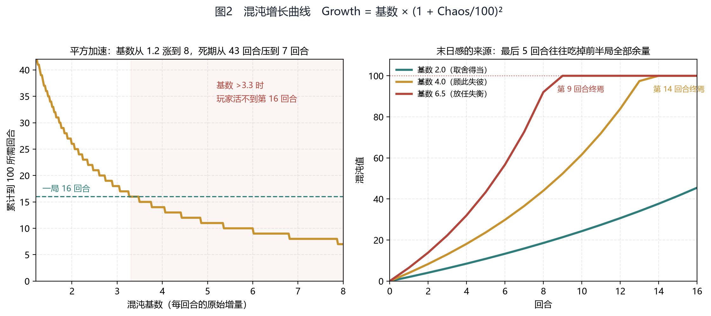
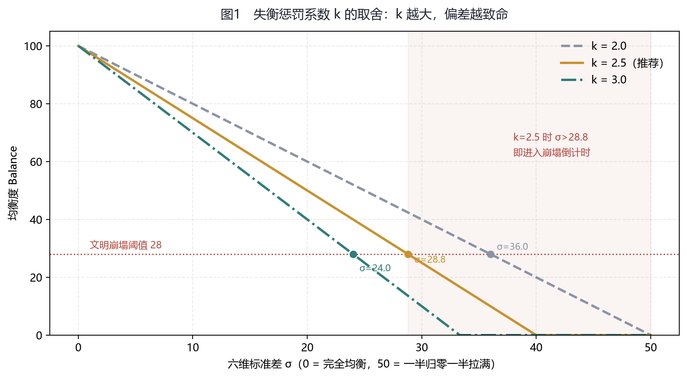
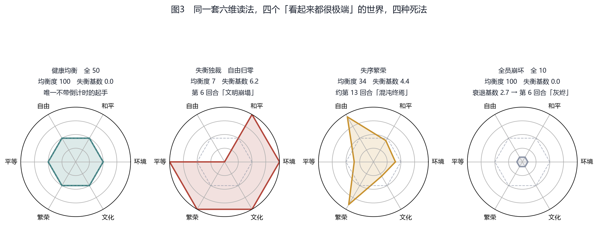
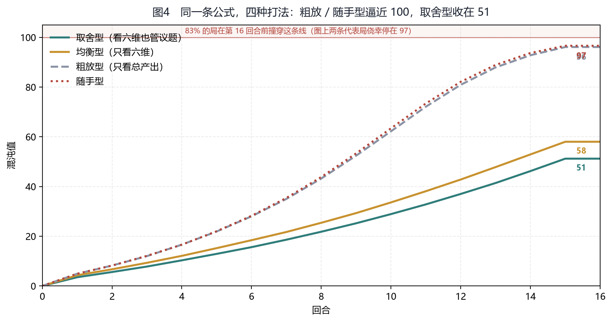

# 幻兽星河 Aether Beast　游戏设计文档 v0.1

| 项 | 内容 |
|---|---|
| 版本 | v0.1（规则定稿、内容骨架、未实现） |
| 日期 | 2026-11-11 |
| 定位 | 回合制文明平衡模拟 · 单机 · Roguelite |
| 面向 | 从 0 开始实现的第一个可玩版本（MVP） |
| 配套 | 《数值配平表-幻兽星河-v0.1.xlsx》——所有数字以那张表为准，本文只认规则 |
| 决策状态 | 三项已锁定（2026-11-11）：k=2.5　·　善恶=背景漂移　·　静水保留。详见 §12 |
| 依据 | 《幻兽星河 aether beast》设定稿 + 《平衡值计算》公式稿 |

> **本文的一句话立场**：这不是一个「打怪升级」的游戏。玩家的操作对象是**六个数字和一条倒计时**，乐趣来自「我明知道会伤害谁，还是得这么做」。

---

## 1　体验目标

### 1.1 一句话

你是宇宙意志派来修失衡的神兽。每颗星球给你 16 次干预机会，每一次都必然有人受益、有人受损。你要在**六维权衡**和**善恶自持**两条天平上同时走钢丝，而混沌条从不给你从容的时间。

### 1.2 三个动词（整个游戏只做这三件事）

| 动词 | 玩家实际在做什么 | 检验标准 |
|---|---|---|
| **权衡** | 比较两个都不干净的选项，挑一个自己能接受的代价 | 如果某一局里出现过「三个选项都不好选」，这一局就成立 |
| **见证** | 看到自己上一回合的决定在第 8 回合以另一种形式回来 | 每张卡的效果必须在 2–6 回合内被玩家感知到，不能只在数字里 |
| **留下** | 死后回到星海，选择带什么去下一颗星球 | 轮回界面必须让玩家感到「损失」和「继承」同时发生 |

### 1.3 明确不做（至少在 v0.1）

- **不做实时战斗**。原始设定「AI 不能修改战斗规则」这条在 MVP 里没有对象——本版没有战斗，神兽能力用于干预世界，不用于打架。
- **不做 3D**。旧版 `index.html` 是 Three.js 的 3D 收集玩法，与本设计不是同一个游戏；代码版落地时直接替换。
- **不做数值预测提示**。不给玩家显示「选这个之后均衡度会变成多少」。理由见 §8。

---

## 2　核心循环

### 2.1 一局（一颗星球，16 回合）

```
选神兽形态 ──▶ 生成星球（主议题 + 势力 + 初始六维）──▶ 回合循环（16 次）
                                                        │
                        ┌───────────────────────────────┘
                        ▼
        ① 局势播报（一句话，告诉你哪条维度正在塌）
        ② 出卡（1 张主议题卡 / 支线卡 / 星象转折）
        ③ 抉择（3 个选项，各带六维 Δ、善 Δ、恶 Δ）
        ④ 结算（六维 → 均衡度 → 混沌 → 议题压力 → 触发检查）
        ⑤ 反馈（半句旁白 + 数字变动 + 势力表态）
                        │
                        ▼
        终局判定（三死法 / 六结局）──▶ 星海轮回（三选一）──▶ 下一颗星球
```

### 2.2 为什么是 16 回合

不是拍的。按 v0.1 的混沌公式，一局的**平均基数**只要超过 3.3，玩家就活不到第 16 回合（见下图）。16 回合正好卡在「认真权衡能收在 55 混沌、放任则第 14 回合撞穿」的缝里。



再长就腻：桌面端单回合阅读 + 决策约 90 秒，16 回合 ≈ 24 分钟，正好是一次会话。再短就来不及让「上一回合的账」回来找你。

### 2.3 回合的四种卡

| 类型 | 频率 | 作用 |
|---|---|---|
| 主议题卡 | 约 60–70% | 星球核心矛盾。选对了议题压力回落，选别的则上涨 |
| 支线卡 | 约 20% | 小代价小收益，用来给玩家「喘一口」并试探他的价值排序 |
| 星象转折 | 第 3/8/12 回合定格 | 外部事件，**不可跳过**。作用是让玩家无法靠完美操作免疫混沌 |
| 结局卡 | 第 16 回合 | 不按常规结算，选项直接指向结局 |

---

## 3　数值系统

这一节是本轮工作量最大的部分：我把《平衡值计算》的公式**跑了一遍**（2000 局/组蒙特卡洛 + 单点反解），发现有六处会直接让游戏玩不下去。下面先给结论表，再逐条说明改了什么、为什么改、证据是什么。

### 3.1 校验结论（六处必修）

| # | 问题 | 原文 | 后果 | v0.1 的处理 |
|---|---|---|---|---|
| F1 | 平衡值区间两份文档打架 | 设定稿写 −100~+100、初始 0；公式稿写 0~100 | 两套公式无法共存（`100−Balance` 在负数区会算错） | 统一为 **0~100**，开局 100 |
| F2 | 公式稿的两个举例算不出来 | 例 A「≈90」实际 87.1；例 B「≈20」实际 5.7 | 作者是按感觉写的，后面所有配平都会跟着错 | 重新算，并把结果写进配平表 `02平衡值` |
| F3 | k=2.5 会把「独裁乌托邦」变成急症 | 原文（k=2）下它是 25.5，属慢性失衡 | 换系数后它只剩 6.8，**开局就低于崩塌线 28**，第 6 回合直接死 | 保留这个判罚，但 UI 必须把它画成「急症」而不是「趋势」，否则玩家会以为游戏在欺负他 |
| F4 | 均匀崩坏的世界被读成完美平衡 | 公式只看标准差 | 六维全压到 10 → σ=0 → 均衡度 100 → 混沌基数 0，**玩家发现这个漏洞就无敌了** | 加**衰退项** + **灰烬判定**（见 3.3） |
| F5 | 原参数撑不住 20 回合 | 除子 10 | 基数 5 → 11 回合就死；实测中位死期只有 14–15 回合 | 除子改 **15**，一局定 **16 回合** |
| F6 | 内在平衡公式没处理符号 | `100 − |善−恶|`，善恶各 −100~+100 | 善=100、恶=−100 时算出 −100 | 善恶改为**两张 0~100 的无符号表** |

另外两处属于设计补齐：

| # | 问题 | 处理 |
|---|---|---|
| F7 | 「均衡度<15 持续 10 回合」几乎不可能触发 | k=2 时需要 σ>42.5（接近半0半100）。改成**均衡度<28 连续 6 回合**，让这条死法真的能发生 |
| F8 | 只优化均衡度就能通关 | 加入**议题压力**：不解决主议题，混沌基数每回合涨 0.3。让「均衡」只是必要条件 |

### 3.2 六维与均衡度（原公式，只改系数）

六个维度，0–100，开局全 50：

`环境 Environment`　`和平 Peace`　`自由 Freedom`　`平等 Equality`　`繁荣 Prosperity`　`文化 Culture`

```
μ  = (E + P + F + Q + Pr + C) / 6
σ  = 总体标准差（除以 6，不是 5）      ← 原文未说明，必须钉死
均衡度 Balance = clamp(100 − k·σ, 0, 100)，k = 2.5
```

k 从原文的 2.0 抬到 2.5，理由只有一条：**k=2 时这条线太远**。要跌破崩塌线 28 需要 σ>36，只有「两维归零」这种世界才够格，普通的一次误判根本触发不了任何倒计时，失衡就永远不会成为威胁。k=2.5 把门槛提到 σ>28.8，「四维正常、两维塌陷」就够——那才是玩家真会亲手造出来的局面。



**四个世界样本的真实判决**（这是给策划看的，不是给玩家看的）：

| 世界 | 六维 | σ | 均衡度 | 它会怎么死 |
|---|---|---|---|---|
| 健康均衡 | 全 50 | 0 | 100 | 不会死，只会被议题拖死 |
| 失衡独裁 | 100/100/**0**/100/100/100 | 37.3 | **6.8** | 第 6 回合文明崩塌 |
| 失序繁荣 | 40/45/95/35/90/30 | 26.4 | 34 | 约第 13 回合混沌终焉 |
| 全员崩坏 | 全 10 | 0 | **100** | 第 6 回合灰烬（不是"平衡得很好"） |



### 3.3 混沌（改成一个三源的基数）

原文只有一项：`基数 = (100 − Balance) ÷ 10`。v0.1 拆成三项求和：

```
失衡项   = max(0, (100 − 均衡度) ÷ D)          D = 15
衰退项   = max(0, (50 − μ) ÷ D)                 ← 新增，堵 F4 的洞
议题压力 = p（0–3，开局 1.0；未处置 +0.3，处置 −1.2）

混沌基数 = 失衡项 + 衰退项 + 议题压力
混沌增长 = 混沌基数 × (1 + Chaos/100)^2.0        ← 原平方加速，保留
```

平方项保留不动——**末日感全靠它**：混沌 90 时倍率 3.6，最后 5 回合往往吃掉半局的全部余量。这不是可以调平的东西，这是这个游戏的情绪曲线。

实测轨迹（同一套公式，除子 15，每组 2000 局的混沌均值）：

| 打法 | 第 4 回合 | 第 8 回合 | 第 12 回合 | 第 16 回合 | 存活率 |
|---|---|---|---|---|---|
| 取舍型（看六维 + 治议题 + 管善恶） | 10 | 22 | 37 | **51** | 99% |
| 只看均衡度（不管议题） | 12 | 26 | 44 | 59 | 91% |
| 只看总产出 | 17 | 44 | 82 | 97（多数已死） | 20% |
| 随手乱选 | 17 | 44 | 83 | 97（多数已死） | 17% |



### 3.4 善恶与宇宙平衡

善恶是**两张各自 0–100 的表**，不是一根轴：

- **善**涨：让渡自己的利益、牺牲效率换公平、保护无收益的东西
- **恶**涨：用强制手段达成好结果、把代价转移给没有议价能力的人

这不是「好人坏人」，而是**手段的记账**。所以「牺牲一个村庄救下一座城」会同时拿到 善+2 和 恶+4——结果漂亮，手段留下痕迹。

```
内在平衡 = 100 − |善 − 恶|
宇宙平衡 = 均衡度 × 0.7 + 内在平衡 × 0.3
```

0.7 / 0.3 的配比是有意的：**世界比你自己重要**。玩家可以在一两世里当个偏执的圣人，但只要世界还站得住，结算就不会太难看。反过来，世界崩了，你再"超越善恶"也拿不到好结局。

### 3.5 善恶是背景漂移，不是第三条轴

**已决策：善恶影响世界，但只作为背景因素。** 它不出现在每回合的选择界面上，不设进度条，玩家不会「为了善恶做一个选择」。

规则（`01参数` P19 / P20）：

```
触发：|善 − 恶| ≥ 25
每回合结束时，六维被动偏移 δ = 0.6（不叠加在选项 Δ 上）
  善占优  → 环境 +δ　自由 −δ　平等 +δ　繁荣 −δ　（和平、文化 不动）
  恶占优  → 反向
```

这个方向是有意的：**善不是「安全」的选项，它只是另一种偏斜**。一个纯善的世界会把环境和平等推到很高、把繁荣和自由压到很低——σ 因此上升，均衡度跟着掉。玩家如果以为「一路行善就能赢」，第 12 回合会被自己堆出来的失衡收走。

相反，恶占优会把繁荣和自由推高、平等和环境压低，走的是「用未来换现在」那条路，通向「负债累累」结局。

**为什么不做成显式第三条轴**：三条要同时管的数字会让每回合的界面变成一道三体问题，而本作的核心动作是「在两难之间挑一个」——多一个轴不增加深度，只增加认知负担。做成背景，玩家只在旁白和趋势箭头里感觉到它，这恰好是这件东西应有的分量。

**实测影响（这是我们为什么敢把它做成「背景」）**：末关「坍缩区」的存活率变化是取舍型 91.2%→89.8%、乱选 3.8%→3.6%、只看均衡度 80.5%→81.7%。**差距都在 1–2 个百分点内**——它足够让极端善恶的人感到世界在反噬，但不足以替代「权衡六维」成为主线策略。

阈值 25 是关键：它让一局的前半段几乎不触发（开局善恶都是 0），只有当你连续同向选择八到十次、真的变成了某种人，世界才开始按那个方向偏。**先有行为，后有惯性**。

### 3.6 议题压力（新增，也是唯一新增的系统）

每颗星球一个主议题。它自带一支**不看你脸色的倒计时**：

- 开局 p = 1.0（混沌条从第一回合就在动，玩家第一眼就知道有东西在追他）
- 选了「在主议题维度上取正」的选项 → p −1.2（下限 0）
- 选了别的 → p +0.3（上限 3.0）

为什么非加不可：没有它，只要玩家学会「每次都选让 σ 最小的选项」，均衡度会稳定在 90 以上，混沌基数接近 0，一局会变成一道有标准答案的数学题。议题压力是这道题的**唯一变量**——它逼玩家在两件事里选：**把天平端平，还是把火扑灭**。

---

## 4　神兽

形态不改规则，只改**你出手的重量**：同一张卡，不同形态推的维度不同。

| 形态 | 原型 | 环境 | 和平 | 自由 | 平等 | 繁荣 | 文化 | 能力（每世 2 次） |
|---|---|---|---|---|---|---|---|---|
| 星河鲸龙 | 鲸 + 龙 + 星云 | **1.2** | 1.0 | 1.0 | 1.0 | 0.9 | **1.2** | 长息：本回合混沌增长减半 |
| 赤焰凤凰 | 凤 + 火 + 熔金 | 0.8 | 1.0 | 1.0 | 0.9 | **1.2** | 1.0 | 焚野：一维 +20、另一维 −20，自己选 |
| 苍穹白虎机械体 | 虎 + 雷 + 合金 | 1.0 | **1.2** | 0.9 | 1.0 | 1.0 | 0.85 | 锁定：冻结一维 3 回合 |
| 深海水晶麒麟 | 麒麟 + 水 + 晶簇 | 1.1 | 1.0 | 1.0 | **1.2** | 0.9 | 1.0 | 澄澈：把一维拉回 50 |

设计意图：**倍率是一副枷锁，不是一份礼物**。鲸龙天然推环境与文化，意味着它更难把繁荣拉起来——玩家会被自己的形态逼着走某个倾向，再靠选择硬拗回来。能力则是「把自己制造的坑自己填上」的工具，2 次用完就没有了。

---

## 5　事件卡与势力

### 5.1 卡的构造

每张卡：**1 个场面 + 3 个选项**，每个选项是一笔交易——两块维度上去、两块下来。

**关键设计**：每个选项的六维净和都是 **+2 到 +5**（总产出永远略赚）。真正被消耗的不是总量，是**离散度**。所以「每次都选总收益最大的」是一种看似合理、实则自杀的打法——实测存活率 20%，和随手乱选没有区别。这是本作最核心的一课，必须在第 3 回合前让玩家撞上一次。

首批 24 张卡（6 议题 × 4 张）的完整数值在配平表 `04事件卡池`，字段：六维 Δ ×6、善 Δ、恶 Δ、是否处置议题、归属势力。

### 5.2 势力（v0.2 才启用）

联盟政府（秩序）· 星轨财团（资本）· 青穹环会（环境）· 自由航道（自由）· 求知院（文化）· 平民议会（平等）

v0.1 只把每张卡**归属**到一个势力，用来生成旁白和结局文案（「你这一世的繁荣，是星轨财团替你垫的」）。关系值、势力倒戈、势力专属卡全部放到 v0.2。理由：MVP 的注意力应该全在六维上，多开一个系统会让第一次试玩的人看不懂自己在干什么。

### 5.3 一张卡的完整形态（写作范本）

> **A01　熔炉之烟**
> 城邦的裂解炉昼夜吐出赤尘，河谷的作物已经连着两年歉收。议会把方案摊在你面前，等一个不是人的东西点头。
>
> **① 关停裂解炉，全城断电三个月**
> 　环境 +14　和平 +2　自由 +3　平等 +6　繁荣 −11
> 　善 +4
> 　*旁白：河谷会在春天绿回来。工厂的班表和提前到来的冬天，也得有人认。*
>
> **② 分期加装滤网，污染再拖两年**
> 　环境 +7　自由 +2　平等 +2　繁荣 −4　文化 +1
> 　善 +2　恶 +1
> 　*旁白：你把账推给了两年后的自己，而他大概也会推给再下一个。*
>
> **③ 产出优先，赤尘继续飘**
> 　环境 −9　和平 −2　自由 +1　平等 −3　繁荣 +12
> 　恶 +4
> 　*旁白：今年的产量好得让议会忘了河谷。*

写作规矩三条：① 旁白只写**代价**，不写评价；② 不出现「善/恶」两个字，让玩家自己算；③ 每个选项都能被辩护——如果有一个选项明显是坏的，这张卡就是废卡。

---

## 6　死法与结局

### 6.1 三种死法（优先级从上到下）

| 优先 | 死法 | 条件 | 内在逻辑 | UI 预告 |
|---|---|---|---|---|
| 1 | 混沌终焉 | 混沌 ≥ 100 | 失衡累积成宇宙级裂隙 | 混沌条 + 最后 3 回合暗红脉动 |
| 2 | 文明崩塌 | 均衡度 < 28 连续 6 回合（回升则倒计时 −1） | 社会结构被单一力量吞掉 | 均衡度条变红 + 倒计时数字 |
| 3 | 灰烬 | 六维均值 < 20 连续 6 回合 | 全体衰退，不分裂但全穷 | 「世界活力」变灰 |

三条死法对应三种失败人格：**失衡者**、**独裁者**、**耗竭者**。这才是「没有绝对正确答案」的落地方式——每一种极端都有自己的死法。

倒计时用「回升 −1」而不是直接清零，是为了让玩家在第 5 回合还有一次救回来的机会，而不是一次失手就宣告结束。

### 6.2 六种结局（活到第 16 回合才判）

| 优先 | 结局 | 条件 | 落点 |
|---|---|---|---|
| 1 | 银河长明 | 宇宙平衡 ≥ 80 且任何维度不低于 40 | 不完美，但站得住 |
| 2 | 铁幕之下 | 自由 < 25 且和平 > 80 | 安全得让人窒息 |
| 3 | 万花筒 | 自由 > 85 且和平 < 35 | 什么都在发生，什么也留不下 |
| 4 | 静水 | 所有维度都在 45–55 | 你什么都没改 |
| 5 | 负债累累 | 繁荣 > 85 且环境 < 25 | 用未来换现在 |
| 6 | 余烬 | 以上都不满足 | 活下来了，但说不清算不算赢 |

「静水」是这个游戏的道德核心：**什么都不做也是一种选择，而且它有一个专属结局**。

**已决策：静水保留。** 理由与两个必须配套的设计：

1. **它极难达成，这是刻意的。** 每张卡必然「两块上去、两块下来」，要让六个维度**同时**落在 45–55，意味着你必须一路把每次冲击都抵回去。它不该是一个可以刷的结局，而是「你真的在养护一个世界」的证明。按当前卡池，它比「银河长明」更难——这个难度顺序是对的：**最难的是不变，而不是变好**。
2. **它不能读成「弃疗」。** 判定条件是**六维都在 45–55**，而不是「什么都不选」。每回合必须选，选项必然推动两个维度。玩家的操作强度与其它结局完全相同，只是操作目标不同。
3. **它在叙事上必须给回一个东西。** 静水专属星痕「静水」：跨世效果是视野（提前一回合看到下一张卡），不是数值增益。奖励「看得更清楚」，而不是奖励「不做」。这条是对「鼓励弃疗」这个误读的正面回答。

---

## 7　轮回与星痕

终焉之后不是 Game Over，是**星海轮回**。三个选项，互斥：

| 方案 | 得到 | 失去 |
|---|---|---|
| **回溯** | 回到本世第 8 回合，只改一个选择 | 本世已累积的星痕全部作废；要重打 8 回合 |
| **远航** | 进入下一颗星球，混沌除子 +1（更松） | 世界记忆清空，善恶重置 |
| **重生** | 换一个神兽形态，解锁没用过的 | 上一世所有势力关系清零 |

**星痕**是跨世遗产，由结局决定（长明 / 铁律 / 碎光 / 静水 / 透支 / 余烬），累积 2–3 枚解锁新形态与隐藏结局「宇宙平衡者」。完整效果在 `08神兽与遗产`。

设计意图：让「死」有产出。Roguelite 的死亡如果只是重开，玩家会在第 3 次死亡时退出；只有死亡本身推进了解锁，重复才成立。

---

## 8　信息设计（这一节比数值更重要）

**给玩家看：**

- 六维条（当前值 + 本次 Δ，Δ 用 ↑↓ 与颜色，不用精确预测）
- 混沌条（当前值 + 一个趋势箭头）
- 均衡度（只显示当前值，**不显示**「选完会变成多少」）
- 议题压力（红条，第 4 回合才出现）
- 善 / 恶（两张小条，不显示宇宙平衡总分，也不显示「漂移已启动」——世界的变化自己说话）

**不给玩家看：**

- σ 的具体值
- 任何「如果选 B 则均衡度 = 62」的预测
- 结局判定条件（结局表只存在于文档和配平表里）

理由：一旦把 σ 摊开，游戏就退化成一道求解题——玩家会拿计算器算最优，情绪退场，「我知道会伤害谁，但我还是得这么做」这句话就不成立了。**模糊是设计，不是缺陷。**

唯一的例外是**失衡预警**：当某个选项会让 σ 突破崩塌线（28.8）时，该选项旁边出现一个不解释的红色裂纹图标。玩家会很快自己悟出它的含义——这是可以接受的「泄露」，因为它制造的是恐惧而不是计算。

---

## 9　AI 的边界与内容管线

原始设定的原则是对的——「AI 创造内容，不创造规则」——但要落成可执行的架构，必须加一道闸门：

```
模板（人写）          槽位（固定数值）        皮肤（AI 填）
卡 ID / 议题 / 归属势力 ─┬─ 六维 Δ ×6        ─┬─ 卡名
     ↑                  ├─ 善 Δ / 恶 Δ         ├─ 场面描写（≤80 字）
     └─ 数值校验器 ←─────┴─ 处置标记            └─ 三句旁白（每句 ≤40 字）
              │
              ├─ 六维每项在 −15 ~ +15
              ├─ 净和在 +2 ~ +5
              ├─ 恰好 3 个选项、每个选项 2 正 2 负
              └─ 通过 → 进池；不通过 → 打回重写
```

**AI 只能改右边的字，碰不到左边的数。** 这样即使 AI 生成出跑题的文案，游戏也不会塌——最坏的结果是一张卡读起来怪，不是一个世界崩掉。

生成时机：**离线批量 + 人工抽检**，不做运行时实时生成。理由：① 运行时生成意味着每局的数值不可复现，无法做平衡验证；② 成本不可控；③ 审核延迟会让「出卡」这一秒变得不可预期——而这一秒是回合制的节奏命脉。

v0.1 用**手写 24 张**（已在配平表里），AI 管线放 v0.3，先用它把卡池从 24 张扩到 60+。

---

## 10　技术方案

### 10.1 选型

**单文件 HTML + 原生 JS，无框架、无构建、无后端。**

- 双击就能玩，`file://` 协议直接跑
- 一个文件可以直接扔 GitHub Pages，也可以直接发给别人
- 没有依赖就不会有「装了 Node 却跑不起来」的第一次劝退

### 10.2 模块划分（单文件内的四块）

| 模块 | 职责 | 不允许做的事 |
|---|---|---|
| `DATA` | 24 张卡、6 结局、4 形态的纯数据 | 不含任何逻辑 |
| `ENGINE` | 状态机、数值结算、RNG、终局判定 | 不碰 DOM |
| `UI` | 渲染、输入、动画 | 不含任何数值计算 |
| `AI`（可选） | 只有 `aiFillSkin(cardId)` 一个出口 | 不能写回 `DATA`，只能写进 `SKIN` 缓存 |

这样切分的唯一目的：**ENGINE 必须能脱离 UI 跑**。否则做不了 2000 局自动模拟，也就没法验证「六结局都能出现」。

### 10.3 状态

```js
state = {
  seed, turn, world: {dims:[6], issue:1.0, faction:{}},
  player: {form, good, evil, skillLeft:2},
  chaos, badStreak, ashStreak,
  log: [],           // 用于旁白引用「第 N 回合你做过什么」
  phase: 'select' | 'resolve' | 'ending' | 'rebirth'
}
```

**种子化随机**：`mulberry32(seed)`，所有随机（卡序、星象转折、旁白变体）都走同一个 RNG。同一 seed 必须跑出同一局——这是验证配平的唯一前提。

**存档**：`localStorage` 存 `state` 与已解锁星痕。刷新可续，无账号。

### 10.4 数据格式（一张卡）

```json
{
  "id": "A01", "issue": "环境", "dim": 1, "faction": "青穹环会",
  "name": "熔炉之烟",
  "scene": "城邦的裂解炉昼夜吐出赤尘……",
  "options": [
    {"text": "关停裂解炉，全城断电三个月",
     "d": [14, 2, 3, 6, -11, 0], "good": 4, "evil": 0,
     "line": "河谷会在春天绿回来。工厂的班表……"}
  ]
}
```

---

## 11　里程碑与验收

| 阶段 | 产出 | 验收标准（可测，不含主观词） |
|---|---|---|
| **M1 内核** | ENGINE 跑通，无 UI | ① 四个世界样本的均衡度与配平表 `02平衡值` 完全一致（±0.1）；② 混沌逐回合与 `03混沌时序` 一致（±0.5）；③ 三种死法都能被脚本触发 |
| **M2 可玩** | 一局 16 回合 + 三选一轮回 | ① 从开局到轮回全程无卡死；② 刷新后续玩；③ 手机竖屏 375px 下可读 |
| **M3 内容** | 24 张卡 + 6 结局 + 4 形态 | ① 六个结局中「银河长明 / 铁幕 / 万花筒 / 负债累累 / 余烬」五个在 2000 局模拟中各出现 ≥3%；② 「静水」只验可达性（构造一条六维全落 45–55 的脚本轨迹能判出该结局），不设出现率门槛——它是玩家刻意养护出来的，不该被机器人刷出来；③ 没有任何单张卡使胜率变动超过 15 个百分点 |
| **M4 交付** | 替换旧 `index.html` | ① 双击即玩；② 单文件 < 300KB；③ 首屏到可操作 < 1 秒 |

M1 不通过不要碰 UI——**数值错了，再好看的界面也只是让错误显得更专业**。

---

## 12　风险清单

| 风险 | 判断 | 应对 |
|---|---|---|
| **24 张卡读两遍就腻** | 高（这是最可能杀死游玩时长的问题） | v0.3 用 AI 管线扩到 60 张，并按「同一议题不同立场」重组，让玩家第二次见到 A01 时，选项已经变了 |
| **玩家学会 σ 之后变成解题** | 中高 | §8 的信息隐藏 + 议题压力；再加一条：不显示预测，只显示红色裂纹 |
| **选择疲劳**：16 回合 × 16 次抉择 | 中 | 支线卡提供明显的「低风险低收益」出口，让玩家每 4–5 回合能松一次 |
| **AI 文案跑题** | 中 | §9 的校验闸门；文案与数值分离，最坏只坏一张卡 |
| **「灰烬」判定被玩家读成 bug** | 中 | 全员崩坏时 UI 必须显式显示「世界活力 10/100」，让它看起来是设计而不是错误 |
| **16 回合的 24 分钟对手机太长** | 低 | 允许中途存档退出；v0.2 加「快速局」16 回合压缩版 |

**已锁定的三项决策**（2026-11-11 拍板，不再改动）：

| # | 决策 | 落地方式 | 由此产生的代价（认了） |
|---|---|---|---|
| 1 | **k 用 2.5** | `01参数` P02 保持 2.5，崩塌线定在 σ>28.8 | 一局只有 16 回合的容错；玩家第一次误判就可能进倒计时。换来的是「失衡真的会杀人」 |
| 2 | **善恶影响世界，但只作为背景因素** | §3.5 的背景漂移：\|善−恶\|≥25 时每回合 δ=0.6 偏四个维度 | 它永远不能成为主线策略（实测只动 1–2 个百分点）。换来的是每回合界面只有三个选项、一条混沌条 |
| 3 | **静水保留** | §6.2 第 4 结局，判定「六维全在 45–55」，配专属星痕「静水」 | 它是六个结局里最难的一个，且必然会被一部分人读成「鼓励弃疗」，靠 §6.2 的三条配套解释兜住 |

三项里没有一项是「更安全」的选择——它们都在收紧这个游戏。这是有意的：一个平衡模拟游戏如果允许玩家两全，它就没有东西可模拟了。

---

## 附录 A　与原始设定的差异清单

| 原始 | v0.1 | 原因 |
|---|---|---|
| 平衡值 −100~+100，初始 0 | 0~100，初始 100 | 与《平衡值计算》冲突，见 F1 |
| 混沌增益 `(100−Balance)/10` | 三源基数，除子 15 | 见 F5、F4、F8 |
| 均衡度 < 15 持续 10 回合 → 崩塌 | < 28 连续 6 回合 | 原条件 σ>42.5，几乎不可达，见 F7 |
| 善恶各 −100~+100 | 各 0~100 | 见 F6 |
| 善恶只进宇宙平衡评分 | 追加背景漂移（§3.5） | 决策 2：善恶要影响世界，但不能变成第三条轴 |
| 战斗规则、升级规则 | MVP 无战斗、无升级 | 设定稿「AI 不可改战斗规则」在 MVP 无对象 |
| AI 生成神兽/世界/NPC/任务/文明史 | 只生成卡面文案 | 运行时生成会破坏可复现性，见 §9 |
| 5 个 NPC 势力 | 只留归属标签 | MVP 注意力全给六维，见 §5.2 |

---

## 附录 B　文件清单

```
D:\aether-beast-game\
├─ index.html                        旧 v0.2 3D 版（代码版落地时替换）
├─ README.md                         旧版说明（同上）
└─ docs\
   ├─ GDD-幻兽星河-v0.1.md            本文
   ├─ 数值配平表-幻兽星河-v0.1.xlsx     所有数字 + 公式联动
   └─ img\
      ├─ 图1_失衡系数对比.png
      ├─ 图2_混沌加速曲线.png
      ├─ 图3_世界样本雷达.png
      └─ 图4_四种玩法混沌轨迹.png
```

配平表的模拟口径：每组 2000 局、单局 16 回合、合成事件卡（24 张同结构随机生成）、四种策略。复现脚本不在交付范围内，需要时另开。
